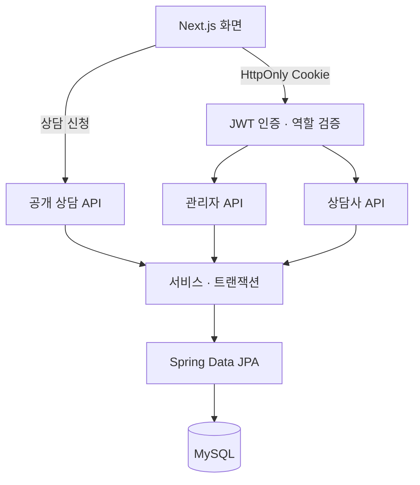
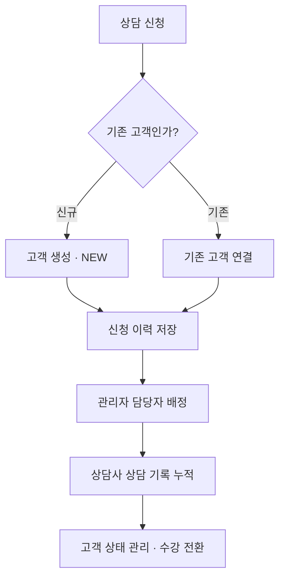

# Education Consulting CRM (교육 상담 고객 관리 시스템) [](https://github.com/WONDongin/project-crm/actions/workflows/ci.yml)

교육 상담 신청부터 담당자 배정, 상담 이력과 수강 전환 상태까지 관리하는 웹 애플리케이션입니다.  
**고객 정보와 상담 이력을 분리하고, 관리자·상담사의 역할 및 담당 고객 기준으로 접근을 제어했습니다.**

<br>

### 📌 서비스 구조



<br>

### 📌 주요 기능
- 상담 기록은 최신순으로 5건씩 조회하며, **본인이 작성한 기록만 수정**할 수 있습니다.
- 첨부파일은 접근 권한과 확장자·파일 내용·용량을 검증합니다.

| 사용자 | 기능 |
| --- | --- |
| 비회원 | 상담 신청, 전화번호·생년월일 기준 기존 고객 식별, 신청 이력 누적 |
| 상담사 | 담당 고객 검색·필터·페이징, 고객 정보·상태·태그 수정, 상담 기록 등록·수정, 첨부파일 관리 |
| 관리자 | 담당 상담사 배정·변경·해제, 계정 생성·수정·비밀번호 초기화, 고객 현황 대시보드 |

<br>

### 📌 상담 처리 흐름
신규 고객은 담당자 배정 시 `IN_PROGRESS`로 전환하고, 기존 고객의 상태는 유지합니다.



<br>

### 📌 핵심 설계

### 고객과 상담 이력 분리

`Customer`는 현재 고객 정보·상태·담당자를, `ActivityLog`는 신청 접수와 상담 이력을 관리합니다. <Br> 기존 고객이 다시 신청하면 고객을 새로 만들지 않고 이력을 추가하며, 고객 생성과 신청 이력 저장을 하나의 트랜잭션으로 처리합니다.

<Br>

### 담당자 변경을 고려한 권한 검증

역할 확인에 더해 서버에서 현재 담당 고객인지 검증합니다. 상담 기록 수정 시 작성자도 확인하고, `SYSTEM` 신청 원본은 수정할 수 없도록 했습니다. <Br> 담당자 배정과 상담 기록 변경에는 고객 행의 **비관적 잠금**을 사용해 권한 확인과 저장 사이의 담당자 변경을 제어합니다.

<Br>

### 계정 변경 시 기존 인증 무효화

JWT를 HttpOnly Cookie로 전달하고, 요청마다 계정 활성 상태·역할·인증 버전을 확인합니다. <Br> 비밀번호 초기화나 이메일·역할·상태 변경 시 인증 버전을 갱신해 기존 토큰을 거부합니다.

<Br>

### 서버 페이징과 연관 데이터 조회

고객 목록과 상담 이력에 서버 페이징을 적용했습니다. <Br>  `@EntityGraph`로 담당 상담사 정보를 함께 조회해 행마다 상담사를 추가 조회하는 N+1 문제를 방지하고, 대시보드 현황은 집계 쿼리로 조회합니다.

**구현 코드:** [상담 신청](backend/src/main/java/com/project/crm/domain/customer/CustomerService.java) · [상담 기록·권한 검증](backend/src/main/java/com/project/crm/domain/activity/ConsultantActivityLogService.java) · [JWT 검증](backend/src/main/java/com/project/crm/config/security/JwtFilter.java) · [고객 조회](backend/src/main/java/com/project/crm/domain/customer/CustomerRepository.java)

<Br>

### 📌 기술 스택

| 구분 | 기술 |
| --- | --- |
| Backend | Java 17, Spring Boot 3, Spring Data JPA, Spring Security, JWT, Gradle |
| Frontend | Next.js 16 (App Router), React, TypeScript, Axios, Zustand, CSS Modules |
| Database | MySQL 8 / 테스트: H2 |
| Test · CI | JUnit 5, MockMvc, Mockito, GitHub Actions |

<Br>

### 📌 테스트 및 CI

- **백엔드 자동 테스트 104개 통과** — 상담 신청·중복 검증, 담당자 권한, 상담 기록 수정, 첨부파일, 계정 관리 등
- `dev`·`main` 대상 PR에서 백엔드 테스트·빌드와 프론트 린트·타입 검사·빌드를 자동 실행
- [테스트 코드](backend/src/test/java/com/project/crm) · [CI 실행 결과](https://github.com/WONDongin/project-crm/actions/workflows/ci.yml)

<details>
<summary>로컬 검사 명령</summary>

백엔드 (Java 17, H2 기반 테스트):

```bash
cd backend
bash ./gradlew clean build
# Windows PowerShell: .\gradlew.bat clean build
```

프론트엔드 (Node.js 22):

```bash
cd frontend/crm-next
npm ci
npm run lint
npm run typecheck
npm run build
```

H2 테스트와 별개로 MySQL 환경에서의 동작 확인이 필요합니다. 프론트 빌드는 Google Fonts 다운로드를 위한 외부 연결이 필요합니다.

</details>
